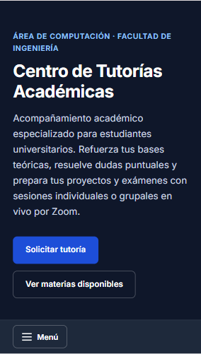
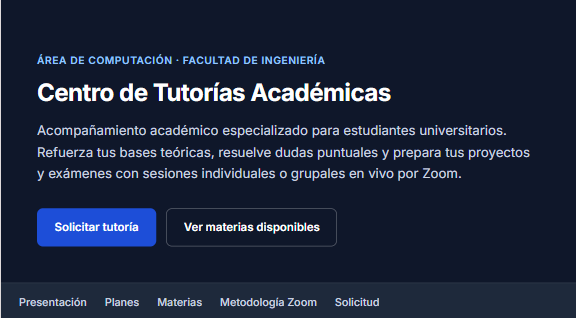
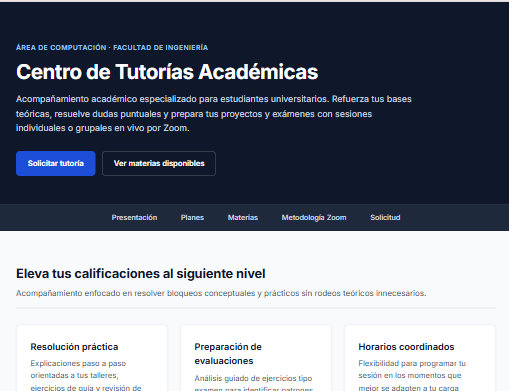

# Centro de Tutorías Académicas · Área de Computación

> **Asignatura:** Aplicaciones Web  
> **Institución:** Universidad Politécnica Salesiana (UPS)  
> **Estudiante:** Erick Herrera  
> **Enlaces del proyecto:**  
---

## 1. Descripción del Proyecto

Sitio web responsivo y accesible diseñado para el Centro de Tutorías Académicas de Computación. Su propósito es brindar acompañamiento personalizado y grupal a estudiantes universitarios en asignaturas troncales (programación, bases de datos, redes y matemáticas aplicadas), centralizando la información de planes, metodología y un sistema de solicitud de asesorías por Zoom.

---

## 2. Decisiones de Diseño e Implementación Técnica

### Estructura y Semántica HTML5
- **Jerarquía estricta:** Un único encabezado `<h1>` en la cabecera, encabezados `<h2>` para delimitar cada una de las 5 secciones temáticas y `<h3>` en tarjetas informativas.
- **Etiquetas semánticas:** Implementación rigurosa de `<header>`, `<nav>`, `<main>`, `<section>`, `<article>`, `<fieldset>`, `<legend>` y `<footer>`.
- **Navegación funcional:** Enlaces internos por ID y enlace de salto directo (`.skip-link`) al contenido principal para lectores de pantalla.
- **Formularios accesibles:** Todos los campos cuentan con su correspondiente `<label for="...">`, pistas asociadas mediante `aria-describedby` y atributos obligatorios explícitos.
- **Medios:** Imágenes optimizadas servidas con carga diferida (`loading="lazy"`) y textos alternativos (`alt`) descriptivos del contenido técnico.

### Estilos y Enfoque Mobile First (CSS3)
- **Desarrollo Mobile First:** La hoja de estilo define la experiencia móvil (1 columna) en su bloque base sin sobrecarga de reglas ni dependencias externas.
- **Variables de diseño:** Centralizadas en `:root` para gestionar la paleta de color (azul institucional, fondos neutros, textos de alto contraste), radios de borde y tipografía.
- **Layouts modernos:** Empleo coordinado de CSS Grid y Flexbox según la naturaleza del contenido.
- **Prevención de desbordamiento:** Configuración de `box-sizing: border-box`, `max-width: 100%` e imágenes fluidas con `object-fit: cover`.
- **Adaptaciones justificadas (2 media queries):**
  1. `@media (min-width: 768px)` *(Tablet)*: Reorganiza las tarjetas de beneficios, planes y materias a 2 columnas; las opciones del paquete pasan a grilla horizontal y el menú de navegación se despliega de forma permanente.
  2. `@media (min-width: 1024px)` *(Escritorio)*: Centra la navegación, distribuye el catálogo de materias en 4 columnas, organiza beneficios y pasos en 3 columnas, y acota el ancho del formulario a 840px para optimizar la longitud de línea de lectura.

### Interactividad Accesible (JavaScript Vanilla)
- **Sin dependencias externas:** Código modular en modo estricto (`'use strict'`).
- **Módulo 1: Menú móvil adaptable:** Gestiona el estado de apertura/cierre mediante el atributo de accesibilidad `aria-expanded`. Permite el cierre automático al pulsar un enlace, al cambiar a pantalla de escritorio o al presionar la tecla `Escape` (devolviendo el foco al botón disparador).
- **Módulo 2: Validación accesible en tiempo real:**
  - Evita el envío de datos inválidos (`novalidate` gestionado dinámicamente).
  - Evalúa formato de correo, longitud de nombres, longitud de identificación, selección obligatoria y caracteres mínimos de consulta.
  - Inserta mensajes de error vinculados como regiones vivas (`aria-live="polite"`).
  - Gestiona el estado visual y semántico con `aria-invalid`.
  - Notifica un resumen del estado del formulario mediante `role="alert"` y traslada automáticamente el foco del teclado al primer campo erróneo.

---

## 3. Pruebas de Calidad y Accesibilidad Realizadas

| Criterio evaluado | Método de verificación | Resultado |
| :--- | :--- | :--- |
| **Validación W3C** | Nu HTML Checker | 0 errores y 0 avisos en HTML. |
| **Navegación por teclado** | Desplazamiento exclusivo con `Tab`, `Shift + Tab` y `Enter` | Flujo secuencial lógico desde el skip-link hasta el pie de página. |
| **Foco visible** | Inspección visual en controles interactivos | Indicador de foco evidente mediante regla `:focus-visible` (3px de contorno azul). |
| **Contraste de color** | Verificación según pautas WCAG 2.1 AA | Razón de contraste superior a 4.5:1 en textos principales y fondos. |
| **Escalabilidad de texto** | Zoom de navegador al 200% | La interfaz se redistribuye sin solapamientos ni pérdida de contenido. |
| **Desbordamiento** | Pruebas en viewport desde 320px | Ausencia total de scroll horizontal involuntario. |

---

## 4. Evidencias de Responsividad

Las capturas de pantalla que acreditan la correcta adaptación del sitio en tres anchos distintos se encuentran documentadas a continuación:

### Vista Móvil (375px)
*Menú colapsado bajo botón accesible, componentes apilados verticalmente a una sola columna y controles táctiles adecuados.*



### Vista Tablet (768px)
*Navegación visible en línea, catálogo de materias y paquetes de asesoría distribuidos en 2 columnas.*



### Vista Escritorio (1024px o superior)
*Distribución completa, navegación centrada, catálogo en 4 columnas y contenedor de formulario con ancho máximo controlado.*



---

## 5. Estructura de Archivos

```text
.
├── index.html           # Estructura semántica y contenido del sitio web
├── styles.css           # Estilos globales, variables y media queries
├── script.js            # Lógica vanilla para menú móvil y validación accesible
├── captura-375px.png    # Evidencia responsiva en móvil
├── captura-768px.png    # Evidencia responsiva en tablet
├── captura-1024px.png   # Evidencia responsiva en escritorio
└── README.md            # Documentación técnica del proyecto
```

---

## 6. Instrucciones de Ejecución Local

1. Clonar el repositorio:
   ```bash
   git clone https://github.com/ErickHerrera12/AplicacionesWebU1.git
   ```
2. Acceder al directorio:
   ```bash
   cd repositorio
   ```
3. Levantar un servidor local (opcional para pruebas):
   ```bash
   # Con Python
   python3 -m http.server 3000
   ```
4. Abrir en el navegador:
   ```text
   http://localhost:3000
   ```
   *(También es posible abrir directamente el archivo `index.html` en cualquier navegador web moderno).*

---

## 7. Referencias Bibliográficas

- DuRocher, D. (2021). *HTML and CSS QuickStart Guide*. ClydeBank Media.
- Frain, B. (2022). *Responsive Web Design with HTML5 and CSS* (4.ª ed.). Packt.
- Robbins, J. N. (2018). *Learning Web Design* (5.ª ed.). O’Reilly Media.
```

